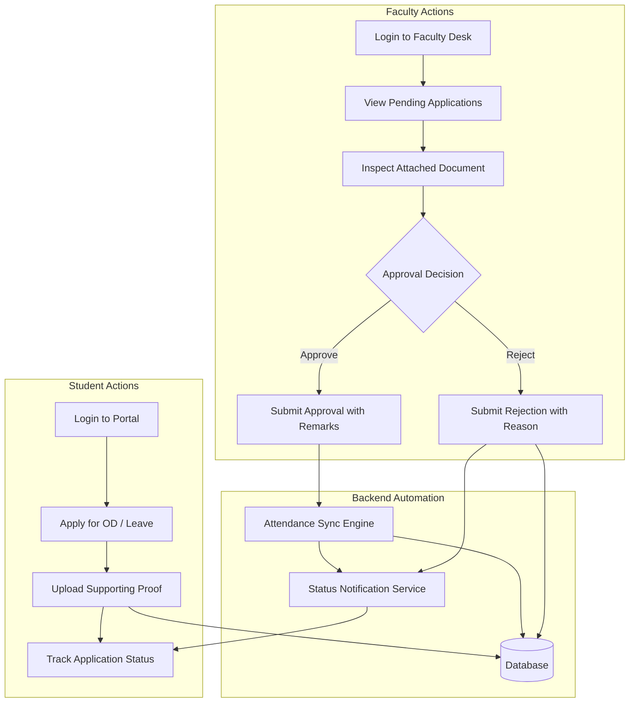

# 📋 Project Proposal & Synopsis

## Project Title
**Automated Student On-Duty (OD) and Leave Approval with Attendance Integration**

---

### 1. Abstract
In higher education institutions, students regularly participate in co-curricular, sports, cultural events, conferences, and paper presentations representing their colleges, for which they are eligible for On-Duty (OD) attendance credit. In parallel, students require medical and casual leaves. Currently, most academic departments process OD and leave requests via manual paperwork, physical signatures, and unofficial messaging channels like WhatsApp groups. This conventional mechanism is plagued by lost documentation, delayed approvals, lack of auditability, and frequent human error when updating attendance registers. 

This project proposes a centralized, web-based automated platform that streamlines the submission, multi-tier verification, approval, and real-time attendance synchronization of student OD and leave requests. The platform incorporates role-based access control (Student, Faculty/Mentor, HOD/Administrator), document verification capabilities, automated attendance adjustment engines, and analytical reporting.

---

### 2. Introduction & Background
Academic attendance compliance is a strict accreditation and university requirement (typically requiring a minimum 75% attendance to qualify for semester examinations). However, students actively engaged in academic competitions, sports meets, hackathons, and symposiums frequently face unfair attendance penalties due to delays in manual OD processing.

When an OD form is submitted physically:
- It requires signatures from the mentor, class-in-charge, event coordinator, and Head of Department (HOD).
- Days or weeks may pass before the paper reaches the attendance entry staff.
- In many cases, manual attendance logs are never adjusted, leading to unjustified detention alerts or exam hall-ticket withholdings.

By migrating this workflow to an automated cloud/web platform, students and faculty gain instant visibility and transparency, eliminating administrative bottlenecks.

---

### 3. Objectives of the Project
1. **Digitize Request Submission:** Provide students an intuitive web dashboard to file OD and leave applications with attached digital proof (e.g., event acceptance letters, certificates, medical prescriptions).
2. **Accelerate Faculty Approvals:** Allow mentors, class advisors, and HODs to review, verify documents, and approve or reject applications digitally with single-click actions.
3. **Automate Attendance Reconciliation:** Directly synchronize approved requests with student attendance logs, automatically tagging approved slots as "OD" or "Approved Leave".
4. **Transparent Tracking:** Provide real-time status updates (Pending, Under Review, Approved, Rejected) to eliminate uncertainty.
5. **Comprehensive Reporting:** Empower academic administrators with instant exports and dashboards to track departmental absenteeism, OD trends, and student participation.

---

### 4. System Architecture & Methodology

#### 4.1 System Modules
1. **Authentication & Profile Module:** Secure JWT/Session-based authentication with role separation (Student, Faculty, Admin).
2. **Application Engine:** Form handling with document upload verification, period/date selector, and request categorization.
3. **Approval Workflow Engine:** Configurable approval routing (Mentor → HOD) with status state machine.
4. **Attendance Synchronization Engine:** Auto-adjusts daily period logs upon approval and dynamically calculates net attendance percentage.
5. **Reporting & Analytics Module:** Visual graphs showing monthly attendance breakdown, OD frequency by department, and exportable reports.

---

### 5. Requirements Specification

#### 5.1 Functional Requirements
- **FR1 (User Management):** Distinct login portals for Student, Faculty, and Admin with encrypted credentials.
- **FR2 (Application Submission):** Support single-day, multi-day, full-day, and specific period-based OD/Leave submissions.
- **FR3 (Proof Attachment):** Multi-format file upload support (PDF, JPG, PNG) with maximum size validation.
- **FR4 (Review & Remarks):** Mandatory remarks on rejection; optional notes on approval.
- **FR5 (Attendance Auto-Update):** Synchronous database update marking targeted periods as 'OD' or 'LEAVE', updating attendance percentages in real time.
- **FR6 (Audit & History):** Immutable timestamped activity logs for all actions.

#### 5.2 Non-Functional Requirements
- **Security:** Password hashing (Bcrypt / Werkzeug), input sanitization against NoSQL Injection/XSS, and RBAC authorization middleware.
- **Usability:** Responsive, mobile-friendly interface accessible on smartphones, tablets, and desktops.
- **Performance:** Response latency under 300ms for routine operations; immediate file uploads.
- **Reliability:** Data consistency with indexed document upserts ensuring attendance is only updated if approval succeeds.

---

### 6. Hardware & Software Specifications

#### 6.1 Hardware Requirements
- **Client Side:** Any computer or smartphone with an active internet connection and modern web browser.
- **Server Side (Development/Host):** Dual-Core 2.0 GHz CPU, 4 GB RAM, 20 GB Disk Storage.

#### 6.2 Software Requirements
- **Operating System:** Windows 10/11, Linux (Ubuntu), or macOS.
- **Frontend:** HTML5, CSS3 / Modern CSS / JavaScript.
- **Backend:** Python (Flask 3.x) with PyMongo.
- **Database:** MongoDB (NoSQL Document Store).
- **Runtime Environment:** Python 3.10+ / MongoDB 6.0+.
- **Version Control:** Git & GitHub.

---

### 7. Implementation Roadmap & Timeline

| Phase | Milestone / Deliverable | Duration |
|---|---|---|
| **Phase 1** | Requirement analysis, SRS documentation, database schema design | Week 1 - 2 |
| **Phase 2** | UI/UX mockups, dashboard wireframes, authentication module | Week 3 - 4 |
| **Phase 3** | OD/Leave application filing, file upload & storage integration | Week 5 - 6 |
| **Phase 4** | Faculty approval workflow, attendance auto-sync engine | Week 7 - 8 |
| **Phase 5** | Admin dashboard, analytics charts, PDF/Excel export reports | Week 9 - 10 |
| **Phase 6** | Unit & integration testing, bug fixing, documentation & presentation | Week 11 - 12 |

---

### 8. Expected Outcomes & Impact
- **90% Reduction in Processing Time:** OD approvals reduced from several days to minutes.
- **Zero Attendance Calculation Errors:** Eliminates human discrepancies when entering OD in physical attendance registers.
- **100% Paperless Environment:** Eliminates printed application forms and physical paper waste.
- **Full Transparency:** Both students and faculty maintain a continuous audit log of all academic activities.
